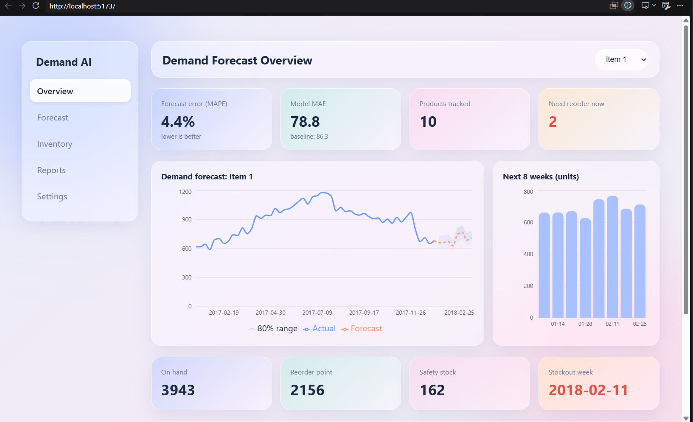
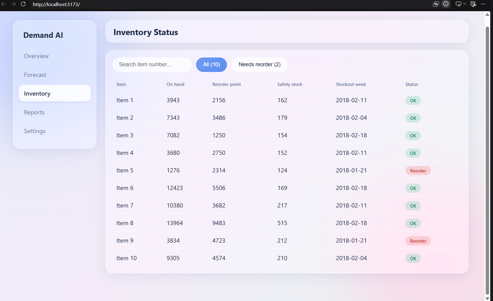
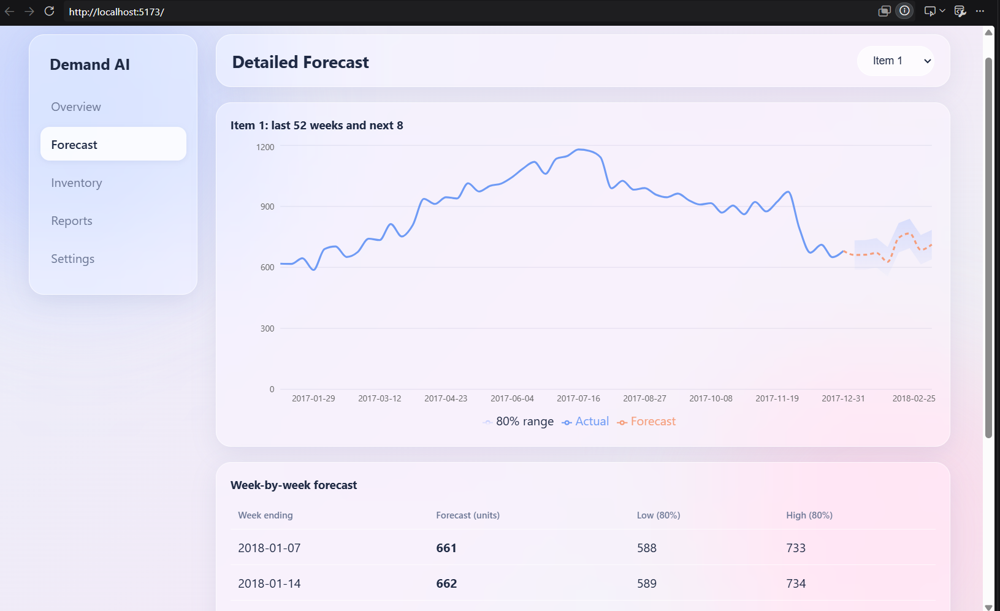
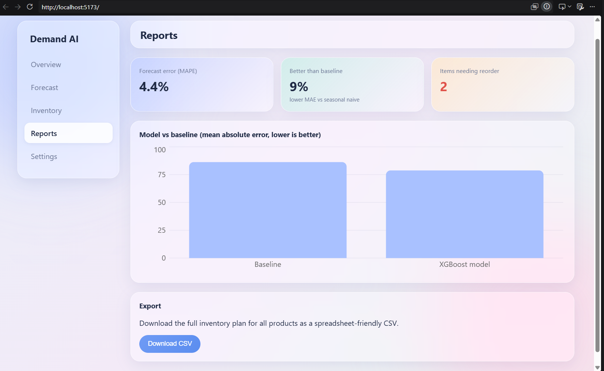

# Demand Forecast Dashboard

Forecasts weekly demand per product and tells a supply planner when and how much to reorder.


**Live demo:** _coming soon_

## The problem
A supply planner needs to know what to reorder next week and when stock will run out. This project turns historical sales into an 8-week forecast and converts it into inventory decisions.

## What it does
- Forecasts 8 weeks of demand per product, with 80% prediction intervals
- Computes safety stock, reorder point, stockout week and suggested order quantity
- Dashboard with forecast charts, inventory status, reports and CSV export
- Glassmorphism UI with adjustable blur and transparency

## Architecture
```
train.csv -> model/train.py -> demand.db -> Express API -> React dashboard
```

| Part | Folder | Role |
|---|---|---|
| Model | `model/` | Cleans data, builds features, trains XGBoost, writes forecasts to SQLite |
| Backend | `backend/` | Express API that serves forecasts and calculates inventory plans |
| Dashboard | `dashboard/` | React + Recharts front end |

## Tech stack
Python (pandas, XGBoost, scikit-learn) · Node.js, Express, SQLite · React, Vite, Recharts

## Model approach
- Weekly demand for 10 products, aggregated from 5 stores (Kaggle Store Item Demand Forecasting data)
- Direct 8-week-ahead forecasting: features use lags of 8+ weeks, so no recursive error build-up
- Features: lagged sales (8, 9, 12, 52 weeks), 4-week rolling mean, week of year, month
- Time-based split: trained on the past, tested on the final 26 weeks
- Compared against a seasonal-naive baseline (same week last year)

## Results
| Model | MAE (units/week) |
|---|---|
| Seasonal naive baseline | 86.3 |
| XGBoost | 78.8 |

MAPE on the 26-week holdout: **4.4%**

## Inventory logic
- Safety stock = Z x forecast error std x sqrt(lead time), with Z = 1.65 (about 95% service level)
- Reorder point = forecast demand during lead time + safety stock
- A product is flagged "reorder now" when stock on hand is at or below its reorder point

## Run locally
**1. Generate forecasts** (the repo includes `demand.db`, so you can skip this)
```powershell
cd model
pip install -r requirements.txt
python train.py
```
Download `train.csv` from Kaggle into `model/` first.

**2. Start the API**
```powershell
cd backend
npm install
npm start
```

**3. Start the dashboard**
```powershell
cd dashboard
npm install
npm run dev
```
Open http://localhost:5173. Copy `dashboard/.env.example` to `dashboard/.env` if the API is not on port 4000.

## Limitations and next steps
- Inventory levels and lead times are **simulated**, not real data
- One global model for all products, with no per-item tuning
- Prediction intervals assume roughly normal errors
- No scheduled retraining and no authentication
- Next: Docker, CI tests, PostgreSQL, SHAP explanations, model comparison (Prophet, SARIMA)

## Data
Kaggle: Store Item Demand Forecasting Challenge.





